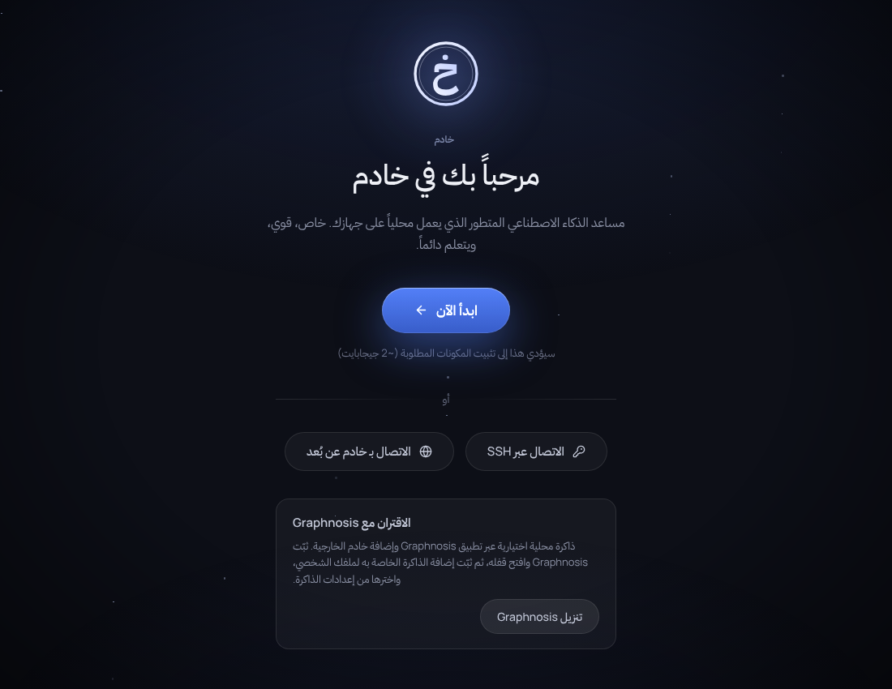
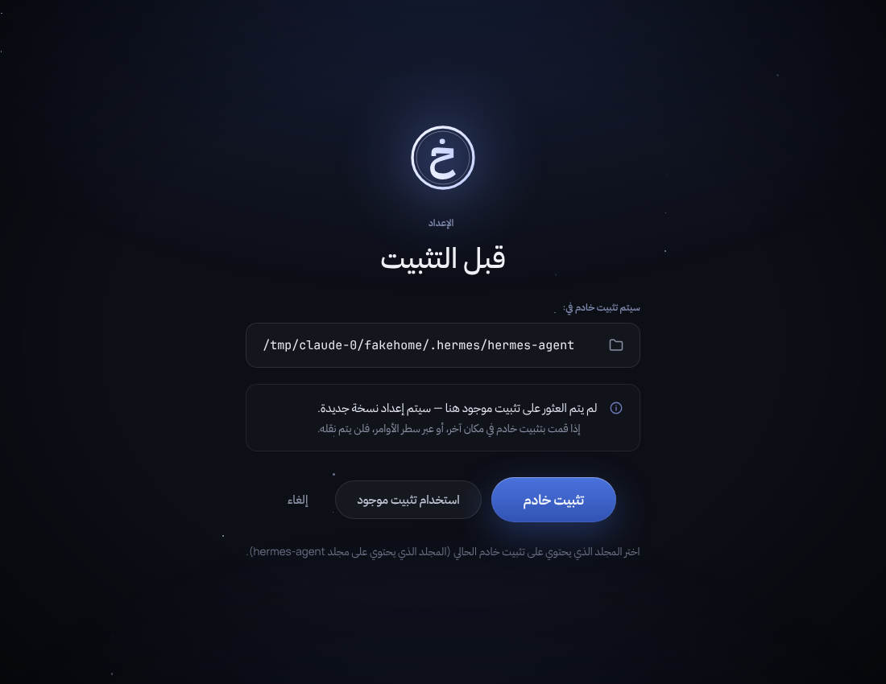
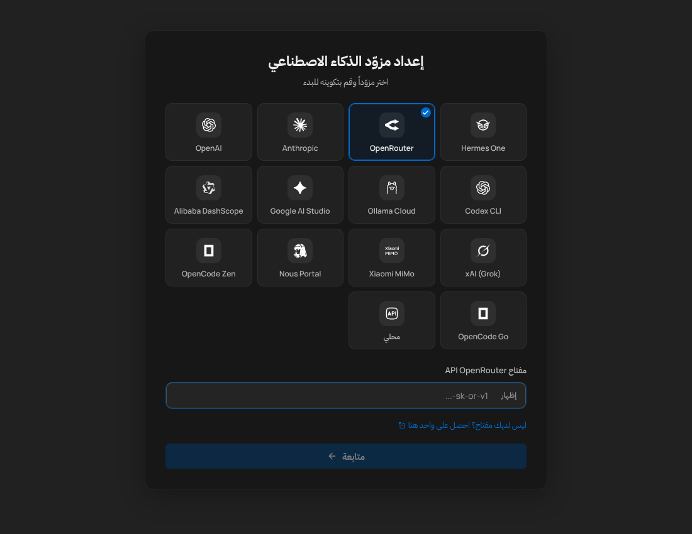
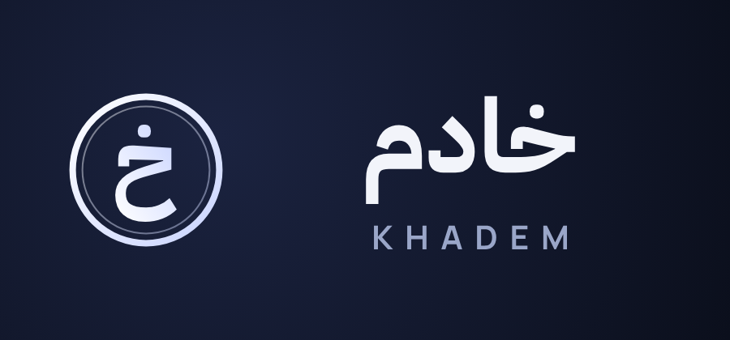

# Khadem Desktop (خادم) — Arabic-first Hermes Desktop

Khadem Desktop is a fork of [fathah/hermes-desktop](https://github.com/fathah/hermes-desktop)
("Hermes One") that ships an Arabic-first desktop agent. It is built so that **upstream can be
merged at any time and Arabic keeps working**: Khadem code lives in Khadem-owned paths, and the
few upstream files it touches carry one-line hooks that a test verifies after every sync.

| Welcome | Setup | Provider |
|---|---|---|
|  |  |  |



## What Khadem adds

| Layer | Where | What it does |
|---|---|---|
| Arabic default | `src/shared/i18n/khadem/active.ts` | New installs open in Arabic (RTL). Users can switch language in Settings. |
| Arabic gap-fill | `src/shared/i18n/khadem/ar-gap-fill.ts` | Arabic for every UI key upstream has not translated yet (applied *under* upstream, so upstream's own translations win). |
| Arabic overrides | `src/shared/i18n/khadem/ar-overrides.ts` | Khadem wording that should win over upstream (empty by default). |
| Branding | `src/shared/i18n/khadem/brand.ts`, `apply.ts` | Rewrites Hermes / Hermes One / Hermes Agent → خادم (Arabic) / Khadem (English) at load time; keys about the external Hermes One cloud account keep its name. |
| Typography | `src/renderer/src/khadem/khadem.css`, `fonts/` | IBM Plex Sans Arabic (OFL) for Arabic glyphs in every font option, Arabic leading, no letter-spacing on Arabic, LTR islands for code, RTL icon mirroring. |
| Brand marks | `src/renderer/src/khadem/brand/` | Khadem seal + wordmark (generated from IBM Plex Sans Arabic by `scripts/khadem/make-brand.py`), shown on onboarding and splash. |
| Hard-coded labels | `src/renderer/src/khadem/hardcoded.ts` | Translates the few English labels upstream renders outside i18n (onboarding eyebrows). |
| Title & notifications | `src/renderer/src/khadem/index.ts`, `src/main/khadem/branding.ts` | Window title and desktop notifications say خادم / Khadem. |
| Persona | `src/main/khadem/persona.ts` | Reset SOUL.md writes the Khadem persona (Arabic for Arabic UI). |
| Agent plugin | `src/main/khadem/agent-plugin.ts`, `resources/khadem-agent-plugin/` | Installs the Khadem agent plugin (from [firothehero/khadem](https://github.com/firothehero/khadem) `plugins/khadem`) into `~/.hermes/plugins/khadem` and enables it once: Arabic persona, خادم-branded agent strings, Arabic defaults, `arabic_text` / `hijri_date` tools, Arabic skills. Works with whatever agent version the upstream installer pins; skipped when the agent is the Khadem fork (which bundles it). |

Under vitest the layer is inert unless `KHADEM_FORCE=1`, so upstream's own tests keep testing
upstream behaviour; `tests/khadem/` forces it on. `KHADEM_DISABLE=1` turns it off.

## Building Khadem installers

```bash
scripts/khadem/build.sh --linux     # or --mac / --win
```

`electron-builder.khadem.yml` extends upstream's `electron-builder.yml` (so upstream packaging
changes still apply) and overrides only the identity — `appId: com.khadem.desktop`,
`productName: Khadem`, Arabic display names — and the **auto-update feed**
(`firothehero/khadem-desktop` releases). Never ship a build made with the base config: its update
feed points at upstream Hermes One releases and would replace Khadem with the stock app.
Upstream's `release.yml` workflow still uses the base config; publish Khadem releases with the
Khadem config.

## Syncing upstream

```bash
scripts/khadem/sync-upstream.sh     # fetch + merge upstream/main, npm ci, scripts/khadem/check.sh
```

`check.sh` = typecheck + `tests/khadem` (incl. the patch-ledger test and a zero-missing-Arabic test)
+ upstream i18n tests + `npx tsx scripts/khadem/i18n-report.mts` (coverage report).
`.github/workflows/khadem-sync.yml` runs it weekly and opens a PR from `khadem/upstream-sync`.

### When a sync reports something

- **Missing Arabic keys** — run `npx tsx scripts/khadem/i18n-report.mts --snippet`, paste the
  printed entries into `src/shared/i18n/khadem/ar-gap-fill.ts`, translate them.
- **Stale / superseded gap-fill keys** — delete them (upstream removed or translated them).
- **New hard-coded English label** — add a row to `src/renderer/src/khadem/hardcoded.ts`.
- **Agent plugin update** — `scripts/khadem/vendor-agent-plugin.sh` (or `KHADEM_AGENT_DIR=../khadem`).

## Patch ledger (hooks in upstream files)

Each line ends with `// KHADEM-PATCH`; `tests/khadem/khadem-layer.test.ts` fails if one is lost.
On a merge conflict in one of these files: take upstream's version, re-add the hook.

| File | Hook |
|---|---|
| `src/shared/i18n/index.ts` | import + `applyKhademLayer(resources);` after the `resources` object |
| `src/shared/i18n/config.ts` | import + `DEFAULT_ACTIVE_LOCALE = khademActive() ? KHADEM_DEFAULT_LOCALE : "en"` |
| `src/renderer/src/main.tsx` | `import "./khadem";` after `main.css` |
| `src/main/soul.ts` | imports + `khademDefaultSoul(getAppLocale(), DEFAULT_SOUL)` in `resetSoul` |
| `src/main/ipc/register.ts` | imports + notification title/body + `await ensureKhademAgentPlugin()` after install |
| `src/main/app/start.ts` | import + `void ensureKhademAgentPlugin()` after `createWindow()` |
| `src/renderer/src/screens/Chat/ChatInput.tsx` | `dir="auto"` on the chat textarea |
| `.gitignore` | `lat.md/.cache/parsed/` |
| `lat.md/lat.md` | index entry for `[[khadem-arabic]]` |

Khadem-owned paths: `src/**/khadem/`, `tests/khadem/`, `scripts/khadem/`,
`resources/khadem-agent-plugin/`, `docs/khadem/`, `.github/workflows/khadem-sync.yml`,
`KHADEM.md`, `lat.md/khadem-arabic.md`, `electron-builder.khadem.yml`.
